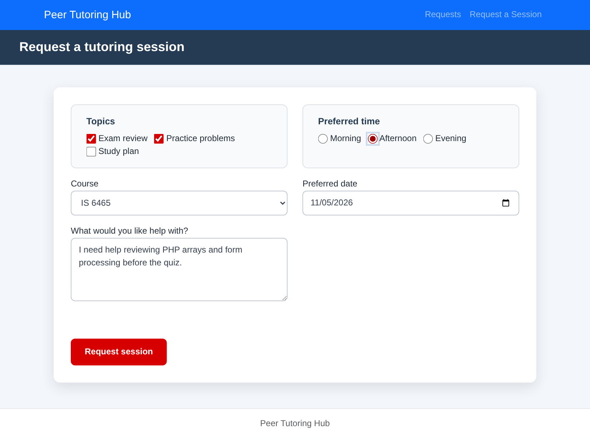
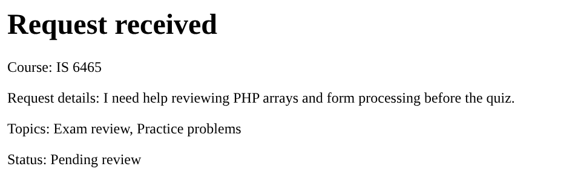

# Lab 4 Notes: Guided Application Walkthrough and Testing

Cody Osmond, IS 6465

## Part 1: Run the application

I started the PHP development server with `php -S 0.0.0.0:8000`, opened `request-form.php`, and submitted a valid request for IS 6465 on November 5, 2026, in the afternoon, with the topics Exam review and Practice problems.

After I clicked **Request session**, the browser sent the form to `process-request.php` with the POST method. PHP validated every value, found no errors, and returned a page titled "Request received." The page lists the course, my request details, the selected topics, and a status of "Pending review." The confirmation page does not show the preferred date or time, and it appears without the site's header, navigation, footer, or styling, because `process-request.php` does not include the shared templates.

**Completed form:**

**Confirmation page:**

## Part 2: Trace the templates

**What content does header.php provide to every page?**
`header.php` provides the opening of every HTML page: the `<!doctype html>` declaration, the `<html lang="en">` element, and the `<head>` section with the character set, the viewport setting for mobile screens, the Bootstrap 5.3.3 stylesheet, the application's own stylesheet, and the page title "Peer Tutoring Hub." It ends by opening the `<body>` element, so each page's own content follows it directly.

**What content does nav.php provide?**
`nav.php` provides the Bootstrap navigation bar that appears at the top of each page. It contains the "Peer Tutoring Hub" brand link and two navigation links: **Requests** (`requests.php`) and **Request a Session** (`request-form.php`). The brand link points to `index.php`, which is not included in the starter project, so that link returns a 404 Not Found error.

**What content does footer.php provide?**
`footer.php` provides the page footer with the text "Peer Tutoring Hub," loads the Bootstrap JavaScript bundle, and closes the `</body>` and `</html>` elements that `header.php` opened.

**Why is require_once appropriate for these files?**
`require` is appropriate because a page cannot work correctly without its header, navigation, and footer. If a file is missing, `require` stops the page with an error instead of continuing with broken HTML, as `include` would. The `_once` part makes PHP load each file only one time, even if more than one file asks for it. This prevents a page from printing the header twice, and for function files such as `includes/validation.php`, it prevents a "Cannot redeclare function" error.

**Where is the shared CSS file linked?**
The shared stylesheet is linked once, on line 7 of `includes/header.php`, with `<link rel="stylesheet" href="css/styles.css">`. It is placed after the Bootstrap stylesheet so the application's own rules take priority. Because every page includes `header.php`, every page receives the stylesheet without repeating the link.

## Part 3: Observe the form controls

**reason**
`reason` is a `<textarea>` where the student describes what they need help with. It is required and limited to 500 characters in the browser. PHP receives it as a **single string** in `$_POST["reason"]`, trims the spaces from both ends, and checks that it is between 10 and 500 characters long.

**topics[]**
`topics[]` is a group of three checkboxes (Exam review, Practice problems, and Study plan) that lets the student choose more than one topic. The square brackets in the name tell PHP to collect every checked box into one **array of strings**, such as `["Exam review", "Practice problems"]`. Only checked boxes are sent, so if none are checked, the key is missing and `?? []` turns it into an empty array. PHP confirms the value is an array and keeps only topics from the allowed list.

**preferredtime**
`preferredtime` is a group of three radio buttons (Morning, Afternoon, and Evening). Because the buttons share one name, the student can choose only one. PHP receives a **single string**, such as `"Afternoon"`, and checks it against the list of allowed times.

**preferreddate**
`preferreddate` is a date input that displays a date picker in the browser. Whatever format the browser displays, it submits the date as a **string in YYYY-MM-DD format**, such as `"2026-11-05"`. PHP converts that string to a date with `DateTimeImmutable::createFromFormat("!Y-m-d", ...)`, confirms the date is real, and checks that it is not before today.

**form_name**
`form_name` is a hidden input with the value `tutoring_request`. The student never sees it. It identifies which form submitted the data. PHP receives it as a **single string** and rejects the submission with "This form submission is not valid." if the value is missing or different. It helps the processing page confirm that a request came from the expected form, but it is not a security control, because anyone can read or change a hidden field.

## Part 4: Test validation behavior

**Test 1: Valid request**

- **Values entered:** Course IS 6465; preferred date November 5, 2026; reason "I need help reviewing PHP arrays and form processing before the quiz."; topics Exam review and Practice problems; preferred time Afternoon.
- **Result:** Accepted.
- **Message displayed:** "Request received," followed by the course, request details, topics, and "Status: Pending review."
- **Business rules checked:** The course must be on the approved list, the reason must be 10 to 500 characters, at least one topic must be valid, the preferred time must be Morning, Afternoon, or Evening, and the date must be a real date that is today or later. All of them passed.

**Test 2: Missing or invalid value**

- **Values entered:** The same values as Test 1, except that I left all three topic checkboxes unchecked.
- **Result:** Rejected. The server returned HTTP status 400.
- **Message displayed:** "Request could not be submitted" with the error "Select at least one valid topic."
- **Business rule checked:** A request must include at least one topic from the allowed list (Exam review, Practice problems, or Study plan).
- **Observation:** The browser blocked an empty reason field before submission ("Please fill out this field.") because the textarea has the `required` attribute. The topic checkboxes have no `required` attribute, so the empty submission reached the server, and PHP's validation caught it. This shows why server-side validation is necessary even when the browser checks some fields.

**Test 3: Past date**

- **Values entered:** Course IS 6495; preferred date October 28, 2026 (the day before I tested); reason "I need help understanding loops."; topic Practice problems; preferred time Morning.
- **Result:** Rejected. The server returned HTTP status 400.
- **Message displayed:** "Request could not be submitted" with the error "Preferred date cannot be in the past."
- **Business rule checked:** The preferred date cannot be before today.
- **Observation:** PHP compares the date with `new DateTimeImmutable("today")`, which uses the server's time zone. Codespaces runs on UTC, so in the late afternoon and evening, Pacific time, the server's "today" is already tomorrow. A request for the student's actual current date could then be rejected as "in the past." Setting the application's time zone would prevent this.

## Part 5: Review testing and CRUD pages

**Validation test results**
`tests/validation-tests.php` reported **PASS for all 10 test cases**: Valid time, Missing time, Altered value, Multiple valid topics, Missing topics, Altered topic, Minimum length, Maximum length, Too short, and Too long.

These tests call the functions in `includes/validation.php`. However, `process-request.php` does not call those functions. It repeats the same checks in its own code, and some messages differ: for example, the test file expects "Choose a valid preferred time.", while the live form displays "Select a valid preferred time." Passing tests therefore show that the validation functions work, but they do not prove that the live form uses the same rules. The tests also do not cover the course or date checks.

**CRUD pages**

| CRUD action | Page |
|---|---|
| Create | `request-form.php` (the form), processed by `process-request.php` |
| Read one request | `request-details.php?request_id=13` |
| Read all requests | `requests.php` |
| Update | `edit-request.php?request_id=13` |
| Delete | `delete-request.php?request_id=13` (confirmation to cancel the request) |

The Update and Delete pages are front-end previews only. Their forms use `action="#"`, so nothing is saved yet. I also noticed two placeholders that will need to change when a database is added: `edit-request.php` always shows request 12's sample data no matter which request is selected, and the hidden `request_id` field in `delete-request.php` is always 12, even though the page heading shows the ID from the URL.

**What query parameter appears in the request details URL?**
The details URL uses the `request_id` query parameter, for example `request-details.php?request_id=13`. The page reads it with `filter_input(INPUT_GET, 'request_id', FILTER_VALIDATE_INT)`. If the value is not a positive whole number, such as `abc`, the page displays "Choose a valid request." If the number does not match a request, such as `99`, it displays "Request not found."

**Why is a GET query parameter appropriate for viewing one request?**
Viewing a request only reads data and does not change anything, which is what GET is designed for. Because the request ID is part of the URL, the page can be bookmarked, shared, refreshed, and reached with the Back button, and each URL always identifies the same request.

**Why should an actual update or delete later use POST rather than GET?**
An update or delete changes data, and GET requests are supposed to be safe to repeat. A GET link can be triggered without the user meaning to change anything: a browser can prefetch it, a search engine can crawl it, and another website can load it in an image tag, which is a cross-site request forgery (CSRF) attack. GET URLs are also saved in browser history and server logs. POST sends the data in the request body, the browser warns before resubmitting it, and it gives the server a place to check a CSRF token. The starter already follows this pattern: the "Cancel request" link only opens a confirmation page with GET, and the actual cancellation is a separate POST form.

## AI use

I used Claude (Anthropic) to help with this lab. Claude ran the starter application, performed the three validation tests and the additional checks described above, captured the screenshots, and drafted these notes from the results. I reviewed each answer against the starter code and my own testing in Codespaces. I did not change any of the provided PHP files.
